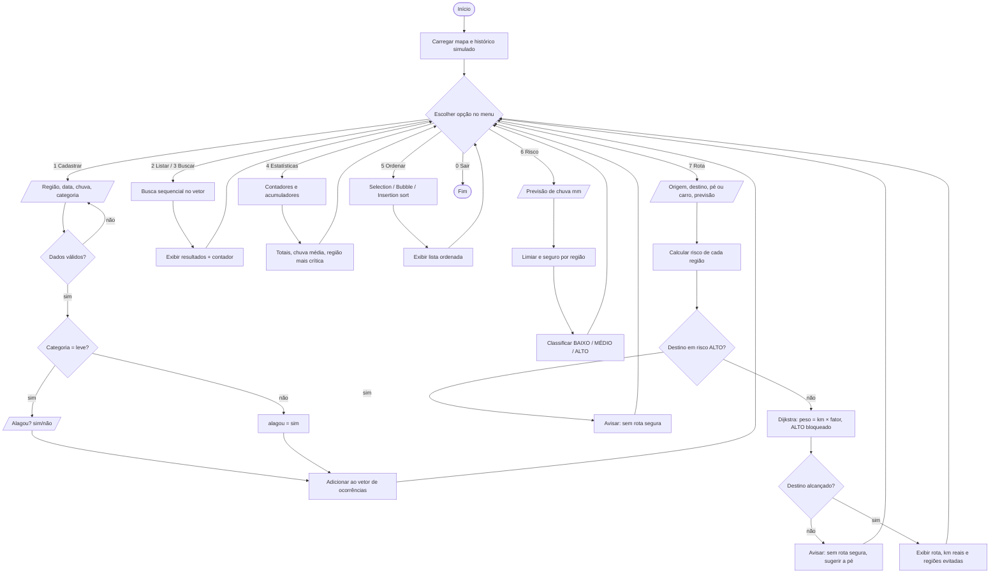

# Diagrama de Atividades: FloodRun

Fluxo principal: **registro → consulta → análise**. A versão em UML/PlantUML está em
[`diagrama.puml`](diagrama.puml). Para gerar a imagem, cole o
arquivo em <https://www.plantuml.com/plantuml>. Esta versão em Mermaid aparece direto no GitHub
e pode ser exportada como PNG em <https://mermaid.live>.

