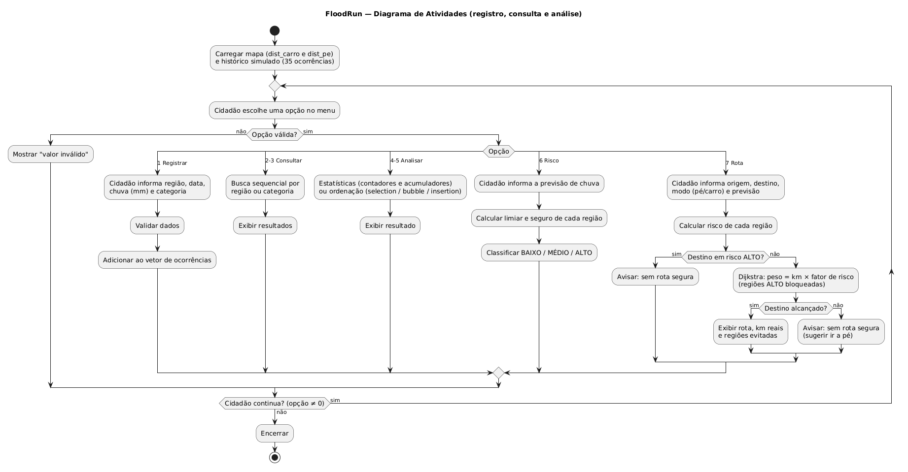

# FloodRun: Mapa Colaborativo de Enchentes com Rota Segura

**Global Solution 2026.2 · CitizenTech · FIAP**
**Disciplina:** Data Structures and Algorithms · **Curso:** Ciência da Computação
**Integrantes:** Fernando Mota – RM567451 · André da Silva Pinto – RM559038

---

## 1. O problema

Todo verão, as chuvas fortes alagam bairros da Zona Norte de São Paulo, principalmente os
próximos ao Rio Tietê e a córregos canalizados, como Limão, Casa Verde e Barra Funda. Quem precisa
se deslocar não sabe **quais regiões vão alagar** com a chuva prevista nem **por onde passar**.
Os aplicativos de mapa comuns mostram o caminho mais curto, que muitas vezes atravessa exatamente
as ruas que alagam. Isso põe pedestres e motoristas em risco: carros ficam presos, pessoas são
arrastadas pela correnteza e o trânsito para.

Ao mesmo tempo, quem mais conhece onde alaga é **o próprio morador**, que vê a rua encher a cada
temporal. Essa informação raramente é registrada de forma organizada.

## 2. Justificativa e proposta

O **FloodRun** junta essas duas pontas:

1. **Mapa colaborativo:** o cidadão registra ocorrências de enchente (região, data, chuva em mm,
   categoria e se alagou). Esse é o "mapa colaborativo de problemas urbanos" pedido no enunciado.
2. **Estimativa de risco:** a partir do histórico, o sistema calcula para cada região com quanta
   chuva ela costuma alagar e classifica o risco (BAIXO, MÉDIO ou ALTO) para uma previsão de chuva.
3. **Rota mais segura:** como um "Google Maps contra enchentes", o sistema calcula o melhor caminho
   entre duas regiões, **a pé ou de carro**, desviando das regiões em risco, e informa quais foram
   evitadas.

Cada novo registro melhora a estimativa: quanto mais a comunidade participa, mais preciso o
sistema fica.

> **Observação:** as distâncias entre bairros e o histórico de chuvas usados no programa são
> **simulados**, para fins acadêmicos. A estrutura permite trocá-los por dados reais (CGE, Defesa
> Civil) sem mudar os algoritmos.

## 3. Conexão com os ODS da ONU

| ODS | Como o projeto contribui |
|---|---|
| **ODS 11: Cidades e comunidades sustentáveis** (principal) | Meta 11.5: reduzir mortes e pessoas afetadas por desastres, incluindo os relacionados à água. O app avisa quais regiões vão alagar e tira as pessoas do caminho da enchente. |
| **ODS 9: Indústria, inovação e infraestrutura** | Usa tecnologia simples (grafos e algoritmos clássicos) para melhorar o uso da infraestrutura viária em situação de crise e gera dados que podem orientar obras de drenagem. |
| **ODS 13: Ação contra a mudança global do clima** | Meta 13.1: reforçar a resiliência e a capacidade de adaptação a riscos climáticos. Chuvas extremas estão mais frequentes, e o app ajuda a população a se adaptar com informação. |

## 4. Estrutura dos dados

Todos os dados ficam em memória e são pré-carregados ao iniciar.

**Registro de ocorrência (`struct`):**
```cpp
struct Ocorrencia {
    int regiao;          // índice no vetor regioes[]
    int dia, mes, ano;
    double chuva_mm;
    int categoria;       // 0 leve · 1 via intransitável · 2 enchente com correnteza
    bool alagou;
};
```

| Estrutura | Tipo | Uso |
|---|---|---|
| `regioes[10]` | vetor de `string` | nomes das 10 regiões da Zona Norte; o índice identifica a região |
| `categorias[3]` | vetor de `string` | nomes das categorias |
| `ocorrencias` | `vector<Ocorrencia>` | histórico (35 registros iniciais); cresce com o cadastro |
| `dist_carro[10][10]` | matriz de `double` | mapa viário em km (0 = sem ligação) |
| `dist_pe[10][10]` | matriz de `double` | mapa para pedestres, com ligações extras (escadaria, passarela) |
| `totalRegiao[]`, `enchentesRegiao[]`, `totalCategoria[]` | vetores de `int` | contadores das estatísticas |
| `risco[10]` | vetor de `int` | risco calculado de cada região para a previsão informada |
| `dist[]`, `visitado[]`, `anterior[]` | vetores | estado do algoritmo de Dijkstra |

O mapa é representado como **grafo** por **matriz de adjacência**: cada região é um vértice e
cada valor diferente de zero na matriz é uma rua (aresta) com sua distância.

**Categorias:** o enunciado cita enchente entre os exemplos de problemas urbanos, e a equipe
escolheu se aprofundar nela. Por isso, em vez de uma única categoria "enchente", as ocorrências
são classificadas por **gravidade**: alagamento leve, via intransitável e enchente com correnteza.
Isso torna as buscas e as estatísticas mais úteis para quem precisa decidir por onde passar. A
estrutura continua aberta a outros problemas (buraco, iluminação, lixo): basta aumentar o vetor
`categorias[]` e a constante `NUM_CATEGORIAS`, e os menus se ajustam sozinhos.

## 5. Algoritmos utilizados

| Algoritmo | Onde | Conteúdo demonstrado |
|---|---|---|
| **Busca sequencial** | busca por região/categoria; limiar e seguro do risco; menor não visitado no Dijkstra | vetores, `for` + `if`, contador |
| **Selection sort** | ranking de regiões por número de enchentes | ordenação, laços aninhados, troca |
| **Bubble sort** (com parada antecipada) | ocorrências da maior para a menor chuva | ordenação, flag booleana |
| **Insertion sort** | ocorrências por data (data convertida em `aaaammdd`) | ordenação, `while` |
| **Contadores e acumuladores** | estatísticas: totais, média de chuva, região mais crítica | uma única passada pelo vetor |
| **Estimativa de risco** | limiar = menor chuva que alagou; seguro = maior chuva que não alagou | busca de mínimo e máximo, decisão |
| **Dijkstra** | rota mais segura | grafo, vetores, busca sequencial, repetição |

**Regra de risco:** região sem enchente no histórico → BAIXO; previsão ≥ limiar → ALTO;
previsão > seguro → MÉDIO; caso contrário → BAIXO.

**Dijkstra com risco:** o custo de cada rua é `distância × fator`, conforme o risco da região de
chegada:

| Risco | Carro | A pé |
|---|---|---|
| BAIXO | ×1 | ×1 |
| MÉDIO | ×3 | ×2 |
| ALTO | bloqueado | bloqueado |

O "vértice não visitado de menor custo" é escolhido por **busca sequencial** no vetor `dist[]`,
sem fila de prioridade. Com 10 regiões, o custo O(N²) é desprezível e o algoritmo fica fácil de
acompanhar. O caminho é remontado de trás para frente com o vetor `anterior[]`. O sistema também
calcula a rota mais curta **sem** considerar a chuva, para mostrar ao usuário quais regiões foram
evitadas e quantos km a mais o desvio custa.

Todos os algoritmos foram **escritos à mão**, sem `<algorithm>`, `std::sort`, `std::find` ou
`priority_queue`.

**Conteúdos da disciplina no código (`main.cpp`):**

| Conteúdo | Onde aparece |
|---|---|
| Algoritmos | estimativa de risco (`riscoRegiao`) e rota mais segura (`dijkstra`) |
| Variáveis e tipos de dados | `struct Ocorrencia` com `int`, `double`, `bool` e `string`; constantes como `N` e `INFINITO` |
| Estruturas de decisão | `if/else` na validação, no risco e no Dijkstra; `switch` no menu principal |
| Estruturas de repetição | `for` em listagens, buscas e ordenações; `while` na leitura validada; `do-while` no menu |
| Funções | 44 funções curtas, com parâmetros por valor e por referência (`cadastrarOcorrencia`, `buscarPorRegiao`, `dijkstra`…) |
| Vetores | `regioes[]`, `vector<Ocorrencia>`, contadores, `risco[]`, `dist[]`, `visitado[]`, `anterior[]`; matrizes do mapa |
| Busca sequencial | `buscarPorRegiao`, `buscarPorCategoria`, `calcularLimiar`, `calcularSeguro`, `menorNaoVisitado` |
| Algoritmos de ordenação | `rankingRegioes` (selection), `ordenarPorChuva` (bubble), `ordenarPorData` (insertion) |
| Contadores e acumuladores | `estatisticas` (totais e soma da chuva), `estimarRisco` (contagem por nível), `distanciaReal` (soma dos km) |

## 6. Funcionalidades

| Opção | Funcionalidade |
|---|---|
| 1 | **Cadastrar ocorrência**, com validação completa (data real com ano bissexto, chuva de 0 a 500 mm, aceita vírgula) |
| 2 | **Listar todas** em tabela alinhada |
| 3 | **Buscar** por região ou por categoria (busca sequencial) |
| 4 | **Estatísticas**: total por região e por categoria, chuva média que causou enchente, região mais crítica |
| 5 | **Listar ordenado**: ranking de regiões, ocorrências por chuva ou por data |
| 6 | **Estimar risco** de todas as regiões para uma previsão de chuva |
| 7 | **Rota mais segura** a pé ou de carro: caminho, distância real, regiões evitadas e passo a passo opcional do Dijkstra |
| 0 | Sair |

**Exemplo (60 mm de chuva, Freguesia do Ó → Santana):**
- *De carro:* Freguesia → Lapa → Barra Funda → Santana (12,0 km), evitando Limão e Casa Verde
  (risco ALTO). A rota mais curta, de 7,5 km, passaria pelas duas.
- *A pé:* Freguesia → Cachoeirinha → Santana (7,0 km), por uma escadaria só para pedestres.
- *Com 75 mm:* não existe rota segura de carro, e o sistema avisa e sugere ir a pé, que continua possível.

**Diagrama de atividades (fluxo principal: registro, consulta e análise):**



*Figura 1: Diagrama de atividades UML do FloodRun (fonte em `diagrama.puml`).*

## 7. Desafios encontrados

- **Adaptar o Dijkstra ao risco.** O algoritmo clássico só usa distância. A solução foi multiplicar
  cada aresta por um fator de risco e "cortar" as arestas que entram em regiões de risco ALTO, sem
  mudar a lógica do algoritmo.
- **Mostrar o que foi evitado.** Para o usuário entender o desvio, rodamos o Dijkstra duas vezes
  (com e sem risco) e comparamos os caminhos.
- **Validação de entrada.** Para o programa nunca travar com letras ou valores absurdos, toda
  leitura é feita como texto e convertida caractere por caractere.
- **Acentos no console do Windows.** Foi preciso ativar UTF-8 (`SetConsoleOutputCP`) e criar uma
  função que alinha as colunas contando caracteres, não bytes ("ã" ocupa 2 bytes).
- **Modelar dados coerentes.** O histórico simulado precisou ser montado para que limiar e seguro
  fizessem sentido em cada bairro e para que os cenários de demonstração fossem realistas.

## 8. Benefícios para a comunidade

- **Segurança:** menos pessoas e veículos entrando em ruas alagadas.
- **Informação acessível:** o morador sabe com antecedência quais bairros tendem a alagar com a
  chuva prevista.
- **Participação cidadã:** cada registro melhora o sistema para todos. O conhecimento do
  morador vira dado.
- **Apoio ao poder público:** o ranking e as estatísticas mostram onde as enchentes se repetem,
  o que ajuda a priorizar obras de drenagem e ações da Defesa Civil.
- **Inclusão do pedestre:** a rota a pé considera escadarias e passarelas que os mapas para
  carro ignoram.

## 9. Conclusão e evolução

O FloodRun cumpre todos os requisitos do enunciado (cadastro, listagem, busca, estatísticas e
ordenação) e vai além: transforma o histórico colaborativo em **decisão prática de rota**. Como
evolução, o sistema poderia receber a previsão de chuva automaticamente de uma API meteorológica,
usar coordenadas reais das ruas e salvar os registros em banco de dados.
